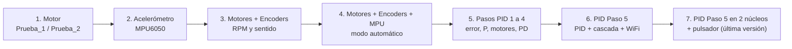
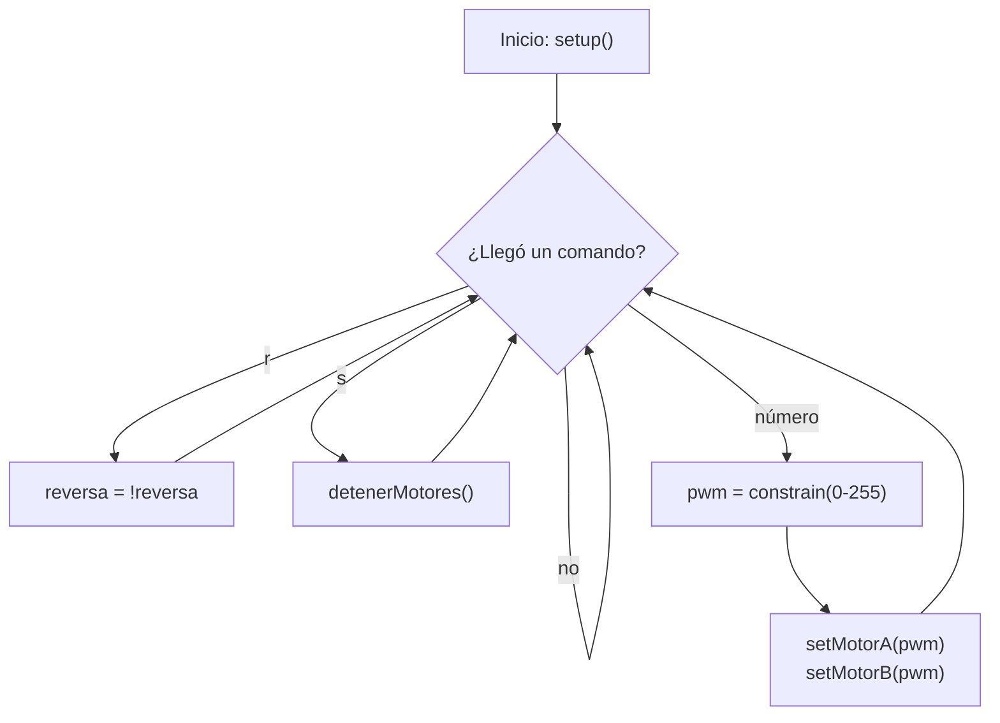
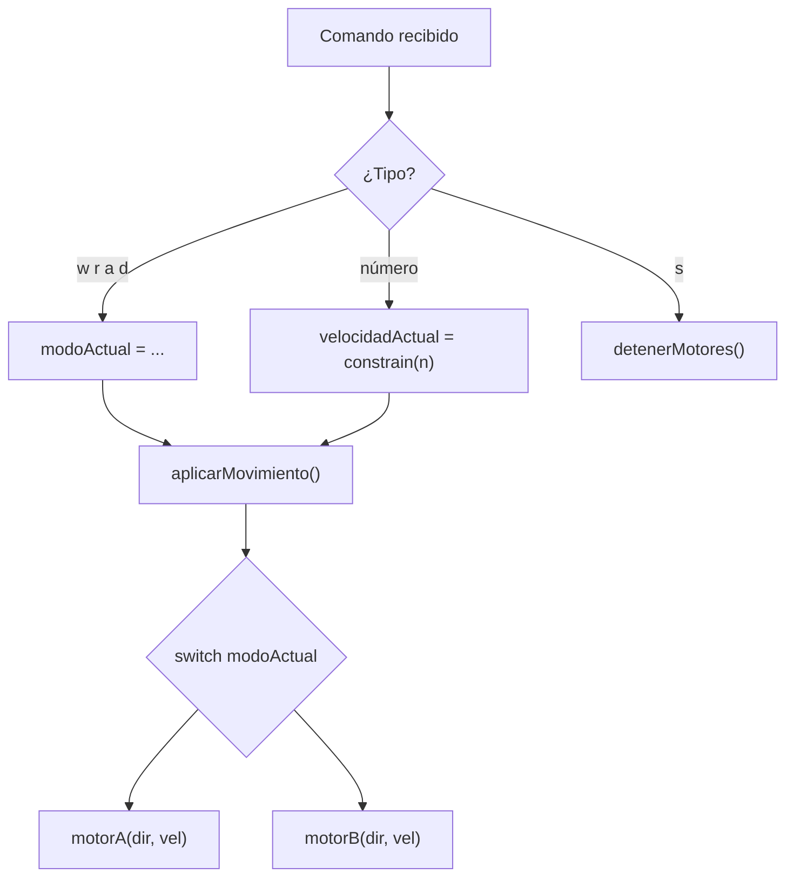
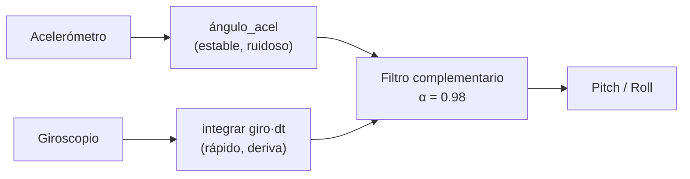
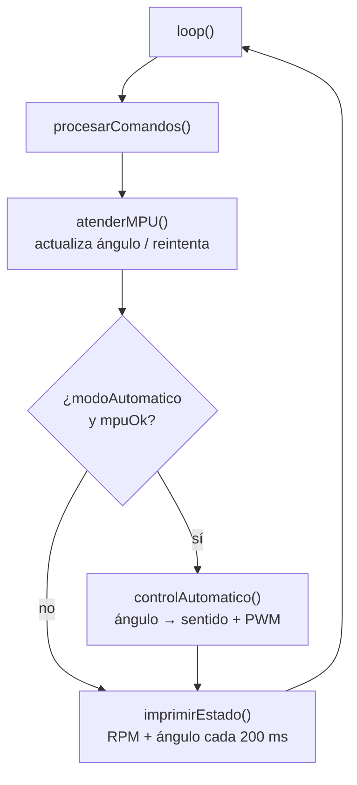
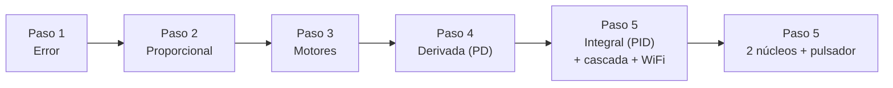
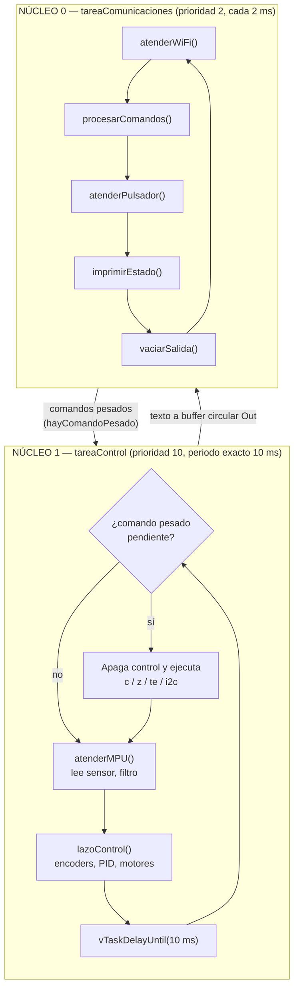
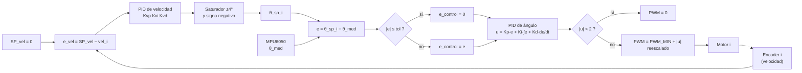
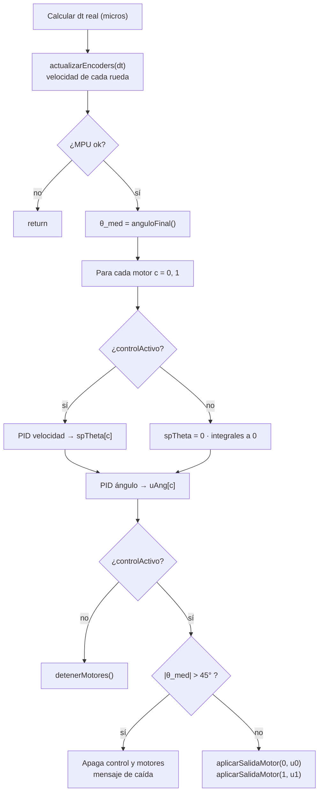
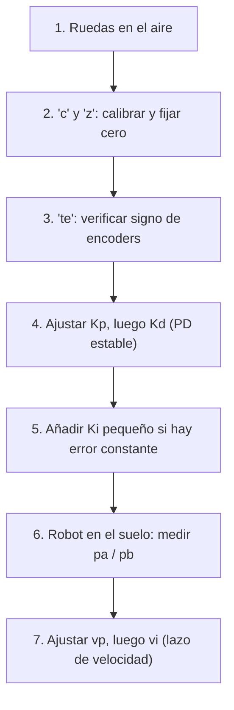

# Proyecto Balacin-inador

Robot **autobalanceado de dos ruedas** (lógica de péndulo invertido) con **ESP32 / ESP32-S3**, que en una etapa posterior será seguidor de línea con cámara.
Este repositorio contiene las **pruebas unitarias** que se hicieron para validar cada componente por separado antes de integrarlos en el controlador final.

---

## 1. Resumen del proyecto

| Elemento | Componente | Para qué sirve |
|---|---|---|
| Microcontrolador | ESP32 (pruebas 1–3) → ESP32-S3 (pruebas siguientes) | Ejecuta el control y la comunicación |
| Driver de motores | TB6612FNG | Puente H: recibe PWM + dirección y mueve los motores |
| Motores | 2 × 25GA370 12 V con encoder Hall (A/B) | Tracción y medición de velocidad |
| Sensor de inclinación | MPU6050 (acelerómetro + giroscopio, I2C) | Mide el ángulo del balancín |
| Alimentación | Batería + reductor LM2596 | Da el voltaje a los motores (VM) |
| Interfaz | Monitor Serial, WiFi/WebSocket, pulsador | Comandos y telemetría |

### Orden de las pruebas (de lo simple a lo completo)



---

## 2. Estructura del repositorio

```
Pruebas_Unitarias/
├── Pruebas_Motor/
│   ├── Prueba_1/                 PWM por Serial
│   └── Prueba_2/                 PWM + adelante/atrás/izquierda/derecha
├── Pruebas_Motor_Acelerometro/
│   └── Prueba_acelerometro/      MPU6050 + filtro complementario
├── Pruebas_Motor_Enconder/
│   ├── test_motor_encoder/       Encoders: pulsos y RPM
│   ├── test_motor_encoder_sentido/   Encoders con signo + sentido
│   └── Motores_Completos_MPU.ino/    Motores + encoders + MPU (ángulo Y)
├── LECTURA_MOTORES_TODO_ORDENADO_1/  Todo integrado + modo automático
└── Calculo_PID/
    ├── PID_Paso1_Error/          e = sp − medido
    ├── PID_Paso2_P/              u = Kp·e
    ├── PID_Paso3_Motores/        u → PWM → motores
    ├── PID_Paso4_PD/             + derivada
    ├── PID_Paso5_PID____/        PID + cascada con encoders + WiFi
    └── PID_Paso5_PID_2nucleos_pulsador____1/   ÚLTIMA VERSIÓN
```

Los `.mp4` dentro de las carpetas son videos de evidencia de cada prueba.

---

## 3. Mapa de pines por prueba

Los pines **cambian** entre pruebas porque se pasó de un ESP32 a un ESP32-S3. Siempre se debe usar la tabla de la prueba que se esté cargando.

| Señal | Prueba_1 / 2 | test_motor_encoder (+sentido) | Motores_Completos_MPU | LECTURA_MOTORES | PID Pasos 1–4 | PID Paso 5 (final) |
|---|---|---|---|---|---|---|
| Placa | ESP32 | ESP32 | ESP32-S3 | ESP32-S3 | ESP32-S3 | ESP32-S3 |
| STBY | 4 | 4 | — | 3.3 V fijo | 3.3 V fijo | 3.3 V fijo |
| AIN1 / AIN2 | 17 / 16 | 16 / 17 | 1 / 2 | 11 / 10 | 11 / 10 | 11 / 10 |
| PWMA | 25 | 25 | 14 | 9 | 9 | 9 |
| BIN1 / BIN2 | 18 / 19 | 18 / 19 | 15 / 16 | 12 / 13 | 12 / 13 | 13 / 12 |
| PWMB | 26 | 26 | 17 | 14 | 14 | 14 |
| Encoder A (fase A / B) | — | 34 / 35 | 18 / 21 | 18 / 8 | — | 18 / 8 (izq) |
| Encoder B (fase A / B) | — | 32 / 33 | 38 / 39 | 38 / 39 | — | 41 / 39 (der) |
| MPU6050 SDA / SCL | 21 / 22 | — | 47 / 48 | 21 / 47 | 21 / 47 | 21 / 47 |
| Pulsador | — | — | — | — | — | 40 (a GND) |

> Nota: en `Prueba_1` el comentario de cabecera dice AIN1=16 / AIN2=17, pero el código define AIN1=17 / AIN2=16. Manda el código.

---

## 4. Pruebas de motores

### 4.1 `Pruebas_Motor/Prueba_1` — Puente H con PWM

**Idea / propósito:** comprobar que el TB6612FNG y los dos motores responden. Es la prueba más básica: si esto no funciona, nada de lo demás sirve.

**Qué hace:** recibe por el Monitor Serial un número de 0 a 255 y lo usa como PWM en ambos motores.

| Comando (Serial 115200) | Efecto |
|---|---|
| `0` a `255` | Ambos motores giran a ese PWM |
| `r` | Invierte el sentido de giro (alterna adelante/reversa) |
| `s` | Detiene los motores |

**Funciones**

| Función | Qué hace | Afecta a |
|---|---|---|
| `setMotorA(pwm)` / `setMotorB(pwm)` | Fija pines de dirección (según `reversa`) y escribe el PWM | Un motor |
| `detenerMotores()` | PWM = 0 en ambos | Ambos |
| `setup()` | Configura pines, habilita `STBY`, crea los canales PWM (`ledcAttach`, 5 kHz, 8 bits) | Inicio |
| `loop()` | Lee el Serial e interpreta el comando | Todo |



### 4.2 `Pruebas_Motor/Prueba_2` — Giros del robot

**Idea / propósito:** además de avanzar, comprobar que los motores pueden girar en sentidos opuestos (para virar) y detectar si un motor está montado en espejo.

**Qué hace:** igual que Prueba_1, pero con modos de movimiento que se aplican **de inmediato** con la última velocidad.

| Comando | Modo | Motor A | Motor B |
|---|---|---|---|
| `w` | ADELANTE | adelante | adelante |
| `r` | REVERSA | atrás | atrás |
| `a` | IZQUIERDA | atrás | adelante |
| `d` | DERECHA | adelante | atrás |
| `0`–`255` | Cambia la velocidad en el modo actual | | |
| `s` | Detiene | | |

**Funciones**

| Función | Qué hace |
|---|---|
| `motorA(dirForward, pwm)` / `motorB(...)` | Dirección (IN1/IN2) + PWM de un motor |
| `aplicarMovimiento()` | Según `modoActual` llama a `motorA` y `motorB` con el sentido que corresponde |
| `detenerMotores()` | Velocidad 0 y PWM 0 |

**Idea clave:** `modoActual` y `velocidadActual` son estado global; cualquier cambio de modo o velocidad llama a `aplicarMovimiento()`. Esta estructura (`motorA/motorB/aplicarMovimiento/detenerMotores`) se reutiliza en todas las pruebas posteriores.



---

## 5. Prueba del acelerómetro — `Pruebas_Motor_Acelerometro/Prueba_acelerometro`

**Idea / propósito:** obtener el **ángulo de inclinación (pitch/roll)** del MPU6050, que es la señal de realimentación del controlador de balance. Se usa solo `Wire.h` (sin librerías externas).

**Qué hace**
1. Despierta el sensor (registro `PWR_MGMT_1 = 0`) y verifica que quedó despierto.
2. Calibra el offset del giroscopio promediando 500 muestras con el sensor quieto.
3. Cada 100 ms imprime aceleraciones (g), velocidades angulares (°/s) y pitch/roll (°).

**Funciones**

| Función | Qué hace |
|---|---|
| `mpuEscribir(reg, valor)` | Escribe un registro por I2C y reporta error |
| `mpuLeerRegistro(reg)` | Lee un registro (para verificar que el sensor despertó) |
| `mpuLeerCrudo()` | Lee 14 bytes: acel X/Y/Z, temperatura (descartada), giro X/Y/Z |
| `calibrarGiroscopio()` | Calcula `gyroOffsetX/Y` (promedio de 500 lecturas) |

**Fórmulas**

| Cálculo | Fórmula |
|---|---|
| Aceleración (g) | `raw / 16384` |
| Velocidad angular (°/s) | `(raw − offset) / 131` |
| Ángulo solo con acelerómetro | `pitch = atan2(−ax, √(ay²+az²))`, `roll = atan2(ay, az)` |
| **Filtro complementario** | `ángulo = α·(ángulo + giro·dt) + (1−α)·ángulo_acel`, con α = 0.98 |

El giroscopio es rápido pero se desvía con el tiempo; el acelerómetro es estable pero ruidoso. El filtro combina lo bueno de ambos.



---

## 6. Pruebas de motores con encoders — `Pruebas_Motor_Enconder`

### 6.1 `test_motor_encoder`

**Idea / propósito:** confirmar que **cada encoder genera señal** y poder calcular la velocidad real (RPM) de cada rueda.

**Qué hace:** mueve los motores adelante con un PWM por Serial y cada 200 ms imprime pulsos y RPM de cada motor.

**Cómo funciona un encoder aquí:** una interrupción (`RISING` en la fase A) lee la fase B; si B está en HIGH cuenta +1, si no −1. Así se obtiene también el sentido.

| Función | Qué hace |
|---|---|
| `encoderA_ISR()` / `encoderB_ISR()` | Interrupciones: suman o restan un pulso según la fase B |
| `motorA/motorB/detenerMotores` | Control de motores (igual que antes) |
| Bloque de `loop()` | Cada 200 ms copia y reinicia los pulsos (`noInterrupts()`), calcula RPM e imprime |

`RPM = (pulsos / PULSOS_POR_VUELTA) / minutos`

Se incluye un procedimiento de **calibración manual**: girar el eje a mano 1 vuelta y contar pulsos. Como referencia, el motor es de 100 RPM a 12 V; si las RPM salen el doble o la mitad, `PULSOS_POR_VUELTA` está mal.

### 6.2 `test_motor_encoder_sentido`

**Idea / propósito:** verificar que el **signo** de las RPM sea coherente: en ADELANTE ambos motores deben dar el mismo signo y en REVERSA el signo se invierte.

**Novedades frente a 6.1**

| Novedad | Detalle |
|---|---|
| Calibración real | Se giró cada eje 5 vueltas: Motor A = 4455/5 = **891**, Motor B = 4237/5 = **847** pulsos/vuelta |
| Modos `w` / `r` | `aplicarMovimiento()` con la lógica **invertida a propósito** (`adelante = (modoActual == REVERSA)`), porque en las pruebas "adelante" movía el robot hacia atrás |
| Comando `f` | Pone `STBY = LOW` → motor **libre** (se puede girar a mano) |
| Comando `s` | Detiene pero mantiene `STBY = HIGH` → **frenado corto** (eje duro) |

### 6.3 `Motores_Completos_MPU`

**Idea / propósito:** primera integración de **motores + encoders + MPU6050** en un solo programa, ya en el ESP32-S3. Sirve para ver juntos RPM y ángulo.

**Qué hace:** cada 200 ms imprime pulsos/RPM de cada motor y el ángulo Y (roll). El MPU se lee en cada vuelta de `loop()` para que el filtro tenga buena resolución temporal.

| Función | Qué hace |
|---|---|
| `mpuLeerCrudo()` | Lectura de los 14 bytes del sensor |
| `calibrarGiroscopioY()` | Offset del giroscopio del eje Y |
| `actualizarAnguloY()` | Filtro complementario (α = 0.98) sobre el eje Y |
| `INVERTIR_EJE_Y` | Constante para corregir el signo del ángulo |

---

## 7. Integración ordenada — `LECTURA_MOTORES_TODO_ORDENADO_1`

**Idea / propósito:** dejar **todo el sistema base ordenado y robusto** (estructura de secciones, convención de nombres, diagnóstico I2C) y probar un **modo automático provisional** que reacciona al ángulo. Es el punto de partida del PID.

**Mejoras respecto a la prueba anterior**

| Mejora | Descripción |
|---|---|
| Estructura | Secciones numeradas: dependencias, configuración, variables globales, funciones principales, funciones de apoyo |
| Diagnóstico I2C | `escanearI2C()` lista dispositivos; `WHO_AM_I` debe ser `0x68` |
| Robustez | `mpuLeerCrudo()` devuelve `false` si el sensor no responde; `atenderMPU()` detiene motores y reintenta cada 3 s |
| Cero ajustable | Comando `z` fija el cero de equilibrio (promedia 100 lecturas) |
| Selección de eje | `INCLINA_SOBRE_EJE_Y` elige qué eje usa el ángulo |

**Comandos**

| Comando | Efecto |
|---|---|
| `0`–`255` | Fija PWM en el modo actual |
| `w` / `r` / `s` | Adelante / reversa / detener |
| `m` | Activa o desactiva el **modo automático** |
| `c` | Recalibra el MPU (balancín quieto ~2 s) |
| `z` | Fija el cero en la posición actual |

**Modo automático (`controlAutomatico`)**

| Condición | Resultado |
|---|---|
| `|ángulo| < 5°` (zona muerta) | Motores detenidos |
| `5° ≤ |ángulo| ≤ 30°` | PWM proporcional de 60 a 255 (mapeado con `map`) |
| Signo del ángulo | Define adelante o reversa (inclinar adelante → ruedas adelante) |



---

## 8. Construcción del PID por pasos — `Calculo_PID`

El controlador se construyó **un bloque a la vez**, validando cada paso antes de agregar el siguiente.



| Paso | Carpeta | Fórmula | Hardware | Lo que se valida |
|---|---|---|---|---|
| 1 | `PID_Paso1_Error` | `e = θ_sp − θ_med` | Solo MPU | Signo del error y periodo fijo Ts ≈ 10 ms |
| 2 | `PID_Paso2_P` | `u = Kp·e` | Solo MPU | El signo de `u` será el sentido del motor; Kp ajustable en vivo |
| 3 | `PID_Paso3_Motores` | `u → PWM → motores` | MPU + motores | Ruedas giran hacia donde se inclina el balancín |
| 4 | `PID_Paso4_PD` | `u = Kp·e + Kd·de/dt` | MPU + motores | La derivada frena el balanceo |
| 5 | `PID_Paso5_PID____` | `u = Kp·e + Ki·∫e + Kd·de/dt` | MPU + motores + encoders + WiFi | Integral con anti-windup, cascada de velocidad, telemetría WiFi |
| 5 (final) | `PID_Paso5_PID_2nucleos_pulsador____1` | igual | igual | Control en núcleo propio + pulsador de arranque |

### Concepto común a todos los pasos (periodo fijo Ts)

```
θ_sp (0°) ──►(+)──► e = θ_sp − θ_med
              ▲(−)
θ_med (MPU) ──┘
```

El lazo se ejecuta solo cuando pasó `TS_MS = 10 ms` (100 Hz), para que la derivada y la integral usen un `dt` constante.

### Paso 1 — `PID_Paso1_Error`

**Propósito:** comprobar que se calcula bien el error y que el muestreo es estable. Si el ángulo marca +5°, el error debe ser −5°.

| Función | Qué hace |
|---|---|
| `lazoControl()` | A periodo fijo `TS_MS`: mide `tsReal` y calcula `errorAngulo = anguloSetpoint − anguloMedido` |
| `atenderMPU()` | Actualiza el ángulo; si se pierde el sensor, reintenta cada 3 s |
| `anguloFinal()` | Ángulo filtrado menos `anguloCero`, con el signo final |
| `imprimirEstado()` | Imprime ángulo, setpoint, error y Ts real cada 200 ms |

### Paso 2 — `PID_Paso2_P`

**Propósito:** agregar la acción proporcional y poder cambiar `Kp` sin reiniciar.

| Novedad | Detalle |
|---|---|
| `salidaU = kp * errorAngulo` | Salida proporcional (aún sin motores) |
| Comando `k<num>` | Cambia Kp en vivo (ej. `k2.5`) |

### Paso 3 — `PID_Paso3_Motores`

**Propósito:** convertir `u` en movimiento real. **Prueba segura: con las ruedas en el aire.**

| Novedad | Detalle |
|---|---|
| `aplicarSalida(u)` | Signo de `u` = sentido; `|u|` = magnitud del PWM |
| Zona muerta `ZONA_MUERTA_U = 2` | Si `|u|` es menor, motores detenidos (evita temblor) |
| PWM mínimo por motor | `PWM = PWM_MIN + |u|·(255 − PWM_MIN)/255`, compensa la zona muerta mecánica |
| Corte `CORTE_GRADOS = 45°` | Si el balancín cae más que eso, el control se apaga solo |
| Comandos `m` / `s` | Activar o desactivar el control (arranca **desactivado** por seguridad) |

### Paso 4 — `PID_Paso4_PD`

**Propósito:** agregar la derivada, que mide qué tan rápido cambia el error y frena las oscilaciones.

| Novedad | Detalle |
|---|---|
| `derivadaError` | `de/dt = (e_k − e_k−1)/dt`, filtrada con `ALFA_D = 0.3` |
| `primeraMuestra` | Evita un pico de derivada al arrancar o tras fijar el cero |
| `MAX_FALLOS_MPU = 5` | Una lectura I2C fallida suelta se ignora; solo se pierde el sensor tras 5 seguidas |
| `Wire.setTimeOut(20)` | Evita que el bus I2C se cuelgue |
| Comandos `kp` / `kd` | Ajuste en vivo |
| Valores | `Kp = 10`, `Kd = 0` inicial |

### Paso 5 — dos versiones

Ambas añaden la **integral** y un **control en cascada con encoders**; la diferencia es la arquitectura.

| Característica | `PID_Paso5_PID____` | `PID_Paso5_PID_2nucleos_pulsador____1` (última) |
|---|---|---|
| Ejecución | Todo en `loop()` (un solo hilo) | Dos tareas FreeRTOS, una por núcleo |
| Periodo del lazo | Revisión con `millis()` | `vTaskDelayUntil` (periodo exacto de 10 ms) |
| WiFi / impresión | Pueden retrasar el lazo | Aisladas en el núcleo 0 |
| Filtro del ángulo | `α = 0.98` fijo | `α = τ/(τ+dt)` con `dt` real, `τ` ajustable (`tf`) |
| Derivada | Del error filtrado | Del giroscopio (`DERIVADA_DESDE_GIRO`), sin retraso |
| Tolerancia (`tol`) | Sí | Sí |
| Pulsador físico | No | Sí (GPIO 40) |
| Salida de texto | Directo | Buffer circular `Out` vaciado solo por el núcleo 0 |

---

## 9. Última versión: `PID_Paso5_PID_2nucleos_pulsador____1`

Es el programa más completo: **PID de ángulo + PID de velocidad en cascada, un lazo completo por motor, ejecutándose en un núcleo dedicado, con telemetría WiFi y pulsador de arranque/paro.**

### 9.1 Arquitectura de dos núcleos



**Por qué se separó:** si el WiFi o el USB se retrasan, el lazo de control **no** se entera. El núcleo 1 nunca escribe en Serial ni WiFi: solo deja texto en un buffer circular (`Out`, 4096 bytes) que vacía el núcleo 0.

### 9.2 Control en cascada (un lazo por motor)



**Idea:** el lazo interno (ángulo) mantiene el balancín vertical; el lazo externo (velocidad) corrige que el robot no se desplace, pidiéndole al interno que se incline un poco (máx. ±4°) para frenar. El signo del lazo externo es negativo a propósito: con el signo contrario hay realimentación positiva y el robot se escapa.

### 9.3 Flujo del lazo de control (`lazoControl`)



### 9.4 Protecciones de seguridad

| Protección | Valor | Qué evita |
|---|---|---|
| Control arranca desactivado | `controlActivo = false` | Que el robot se mueva al energizar |
| Corte por caída | `CORTE_GRADOS = 45` | Que las ruedas sigan girando con el robot caído |
| Anti-windup por zona | `INTEGRAL_ZONA_GRADOS = 10` | Integrar cuando el error es grande |
| Anti-windup por tope | `INTEGRAL_MAX_U = 50` | Que la integral crezca sin límite |
| Tope del setpoint de velocidad | `SP_MAX_GRADOS = 4` | Que el lazo externo pida inclinaciones peligrosas |
| Pérdida del MPU | `MAX_FALLOS_MPU = 5` | Reaccionar a un ruido aislado; si falla de verdad, apaga motores |
| Comandos pesados | `c`, `z`, `te`, `i2c` | Bloquean el lazo; apagan el control antes de ejecutarse |
| Zona muerta de `u` | `ZONA_MUERTA_U = 2` | Temblor de los motores |

### 9.5 Comandos de la última versión

Se escriben por el Monitor Serial (115200, "Nueva línea") o por la página web vía WebSocket.

| Comando | Efecto |
|---|---|
| `m` | Activa/desactiva el control (igual que el pulsador) |
| `s` | Desactiva el control y detiene motores |
| `c` | Recalibra el MPU (balancín quieto) |
| `z` | Fija el cero en la posición actual |
| `kp<n>` / `ki<n>` / `kd<n>` | Ganancias del PID de ángulo |
| `tol<n>` | Tolerancia ± alrededor del setpoint (0 la desactiva) |
| `vp<n>` / `vi<n>` / `vd<n>` | Ganancias del PID de velocidad, ambos motores |
| `v1p..` `v1i..` `v1d..` / `v2p..` `v2i..` `v2d..` | Lo mismo, solo motor 1 (izq) o motor 2 (der) |
| `e` | Pone en cero las cuentas de los encoders |
| `te` | Prueba de encoders (ruedas en el aire): ambos deben contar positivo |
| `tf<n>` | Constante de tiempo del filtro del ángulo (0.05 a 20 s) |
| `i2c<n>` | Velocidad del bus I2C en kHz (50–400) |
| `pa<n>` / `pb<n>` | PWM mínimo del motor A (izq) / B (der) |

---

## 10. Funciones de la última versión y su efecto en el código general

### 10.1 Funciones principales

| Función | Qué hace | Qué afecta en el código general |
|---|---|---|
| `setup()` | Inicializa motores, encoders, pulsador, WiFi, MPU; crea las dos tareas | Deja el sistema listo; el `loop()` queda vacío (`vTaskDelete`) |
| `tareaControl()` | Bucle del núcleo 1 a 10 ms exactos | Es el **corazón**: de ella depende que el robot se mantenga en pie |
| `tareaComunicaciones()` | Bucle del núcleo 0 (cada 2 ms) | Si falla, el control sigue funcionando |
| `lazoControl()` | PID de velocidad + PID de ángulo por motor; decide el PWM | Escribe `spTheta`, `uAng`, `salidaU` y manda a los motores |
| `atenderMPU()` | Actualiza el ángulo; maneja fallos y reconexión | Si el MPU se pierde: `controlActivo = false` y motores detenidos |
| `imprimirEstado()` | Telemetría en 3 líneas cada 100 ms | Solo lee variables; no modifica el control |
| `ejecutarComando()` | Interpreta todos los comandos | Cambia ganancias, activa/desactiva el control, lanza calibraciones |
| `procesarComandos()` | Lee Serial y la cola del WebSocket | Alimenta a `ejecutarComando()` |
| `atenderPulsador()` | Antirrebote 50 ms; al presionar ejecuta `m` | Alternativa física al comando `m` |

### 10.2 Funciones de apoyo

| Grupo | Función | Qué hace | Afecta a |
|---|---|---|---|
| Motores | `motorA()` / `motorB()` | Dirección (IN1/IN2) + PWM | Salida física |
| | `aplicarSalidaMotor(c, u)` | `u` → zona muerta → PWM con mínimo propio → sentido (usa `INVERTIR_SENTIDO_MOTORES`) | Cómo reacciona cada rueda |
| | `detenerMotores()` | PWM = 0 | Seguridad |
| | `reiniciarIntegrales()` | Pone en cero las integrales de ángulo y velocidad | Evita saltos al cambiar ganancias, activar o parar |
| Encoders | `ISR_encIzq()` / `ISR_encDer()` | Decodificación de cuadratura ×4 con tabla `TABLA_QUAD` | Actualizan `cuentasIzq/Der` |
| | `iniciarEncoders()` | Pines con pull-up e interrupciones `CHANGE` en A y B | Inicio |
| | `leerCuentas()` | Copia atómica de las cuentas (sección crítica) | Evita lecturas corruptas |
| | `actualizarEncoders(dt)` | Velocidad en rpm con filtro `ALFA_V = 0.35` | Entrada del PID de velocidad |
| | `pruebaEncoders()` | Mueve cada motor 1 s y muestra las cuentas | Verificar `ENC_INVERTIR_*` |
| MPU6050 | `mpuLeerCrudo()` | Lee 14 bytes por I2C; `false` si falla | Base de todo el ángulo |
| | `calibrarGiroscopio()` | Offsets con 500 muestras | Precisión del ángulo |
| | `actualizarAngulo()` | Filtro complementario con `dt` real | Variable `anguloInclinacion` |
| | `anguloFinal()` | Ángulo menos cero, con signo final | Es el `θ_med` del PID |
| | `ponerCeroActual()` | Fija el equilibrio (promedia 100 lecturas) | Cambia `anguloCero` |
| | `iniciarMPU()` / `escanearI2C()` | Despierta, verifica `WHO_AM_I`, calibra / lista dispositivos | Inicio y reconexión |
| Comunicación | `conectarWiFi()` / `atenderWiFi()` | Conexión, mDNS (`balancin.local`), WebSocket puerto 81, reintentos | Telemetría remota |
| | `eventoWebSocket()` | Encola los comandos recibidos | No ejecuta nada directo |
| | `vaciarSalida()` | Envía el buffer `Out` a Serial y WebSocket | Solo núcleo 0 |

### 10.3 Parámetros que más cambian el comportamiento

| Parámetro | Valor actual | Efecto si se sube |
|---|---|---|
| `KP_INICIAL` | 37.5 | Reacciona más fuerte al error; demasiado alto oscila |
| `KD_INICIAL` | 1 | Más amortiguación; demasiado alto vibra por ruido |
| `KI_INICIAL` | 0 | Elimina error constante; empezar con valores pequeños |
| `TOL_INICIAL` | 0.5° | Más banda donde P e I ven error cero |
| `KVP_INICIAL` | 0.07 | El robot corrige más rápido su desplazamiento |
| `TAU_FILTRO_INICIAL` | 1.5 s | Confía más en el giroscopio y menos en el acelerómetro |
| `INVERTIR_SENTIDO_MOTORES` | `true` | Invierte hacia dónde empujan las ruedas; si el balancín cae más rápido, cambiarlo |
| `ENC_INVERTIR_IZQ / DER` | `false / true` | Corrige el signo de las cuentas de cada rueda |
| `PWM_MIN_A / B` | 19 / 19 | PWM mínimo de arranque; medirlo con el robot en el suelo |

### 10.4 Orden recomendado de puesta a punto



---

## 11. Observaciones sobre el código actual

Cosas detectadas al documentar; conviene revisarlas:

| Dónde | Observación |
|---|---|
| `PID_Paso5_PID_2nucleos_pulsador____1.ino`, línea 226 | `#define ANGULO_CERO -4.88---   -5.81` no es un valor válido y probablemente no compila. Debería ser un solo número, por ejemplo `-5.81` |
| Mismo archivo, línea 5 | La cabecera dice "MPU6050 + motores (sin encoders)", pero esta versión sí usa encoders; el comentario quedó desactualizado |
| `PID_Paso5_*` (ambas) | `WIFI_SSID` y `WIFI_PASS` están escritos en el código. Si el repositorio es público, conviene moverlos a un archivo aparte ignorado por git |
| `ejecutarComando()` | Hay llamadas duplicadas a `reiniciarIntegrales()` (en `m` y `s`); inofensivas pero sobran |
| Motores A/B | El texto dice "Motor A = izquierdo, B = derecho"; en el Paso 3 los `PWM_MIN` estaban intercambiados respecto al Paso 4 y 5, así que verificar el mapeo con `pa` / `pb` |

---

## 12. Cómo cargar una prueba

1. Instalar **Arduino IDE** con el core **ESP32 Arduino 3.x** (usa `ledcAttach` por pin).
2. Para la última versión, instalar la librería **WebSockets** de Markus Sattler.
3. Seleccionar la placa correcta (ESP32 para pruebas 1–3, ESP32-S3 para el resto).
4. Abrir el Monitor Serial a **115200** con "Nueva línea" activado.
5. Revisar la tabla de pines de la sección 3 antes de conectar.
6. Para el PID: **siempre con las ruedas en el aire** la primera vez.

> Con el core ESP32 2.x hay que cambiar `ledcAttach` por `ledcSetup` + `ledcAttachPin` (explicado al final de `Prueba_1` y `Prueba_2`).
