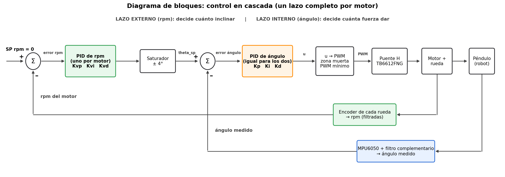
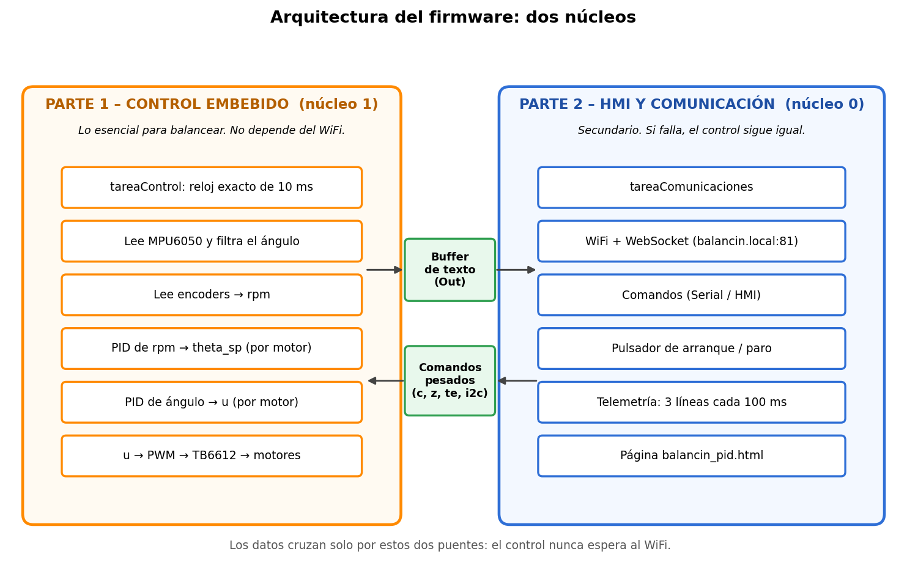
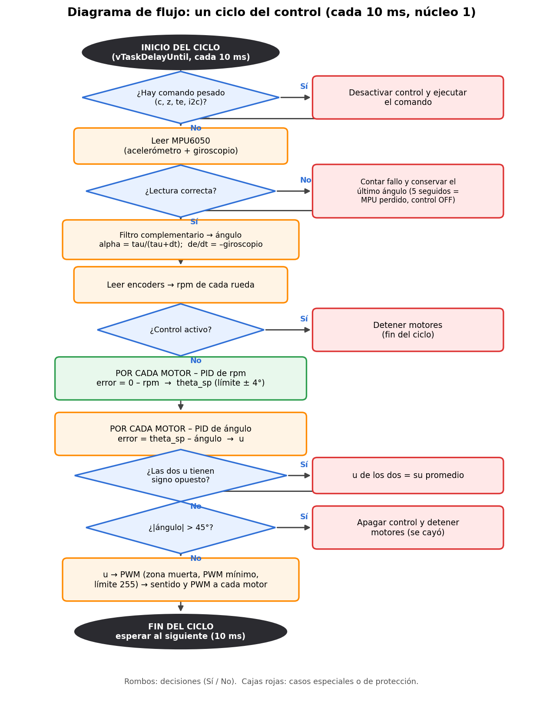
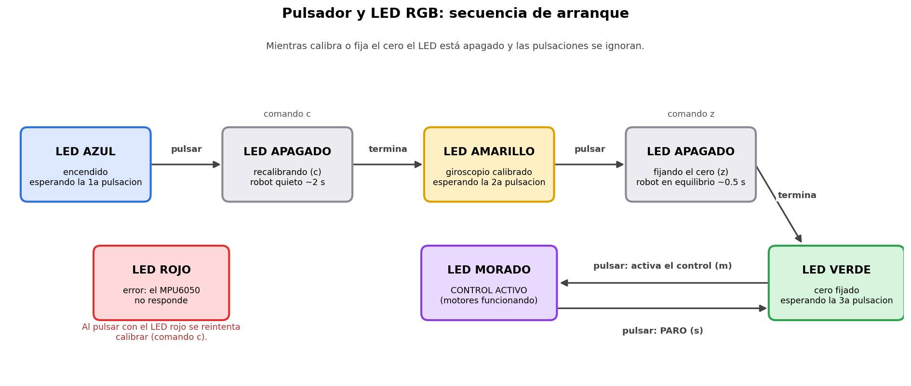
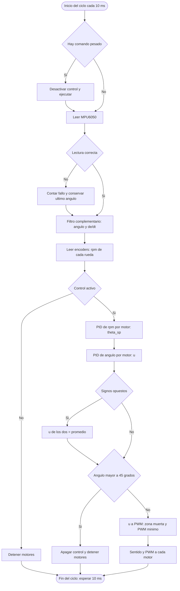

# 0. Cómo usar esta guía

Esta guía explica **qué hace cada parte del firmware** `Balacin_V1.ino` y **por qué está hecho así**. Está pensada para que todo el equipo pueda explicar el proyecto en la defensa, aunque no haya escrito esa parte.

Orden recomendado de estudio:

1. Lee el **punto 1** (qué es el robot) y el **punto 2** (conceptos de control). Son la base.
2. Mira los cuatro diagramas de la carpeta `documentos/diagramas/` (están también dentro de esta guía).
   Antes de compilar el firmware lee el **punto 13.2** (el archivo `secretos.h`).
3. Abre `Balacin_V1.ino` y sigue el **punto 4** sección por sección.
4. Practica las preguntas del **punto 10**.
5. Si hay que dibujar el diagrama de flujo a mano o en otra herramienta, usa el **punto 11**.

> **Una advertencia honesta.** Algunos números de esta guía vienen de una *simulación* que hicimos con parámetros supuestos (sirve para comparar ideas, no para dar ganancias finales). Cuando eso ocurre, la guía lo dice. Las ganancias definitivas se afinaron en el robot real.

# 1. El proyecto en un minuto

Es un **robot balancín de dos ruedas**: se mantiene de pie solo, como un péndulo invertido, moviendo las ruedas hacia el lado al que se inclina. Piensa en equilibrar una escoba en la palma de la mano: si la escoba cae hacia ti, mueves la mano hacia ti.

## 1.1 Hardware

| Elemento | Qué hace |
|---|---|
| ESP32-S3 (DevKitC-1, módulo N16R8) | El "cerebro": corre el control y el WiFi. Tiene dos núcleos. |
| MPU6050 | Sensor de inclinación (acelerómetro + giroscopio) por I2C. |
| TB6612FNG | Driver de motores (puente H): convierte PWM y dos pines de dirección en giro. |
| 2 motores 25GA370 de 12 V, 100 RPM, con encoder Hall | Mueven las ruedas. Trabajan a 7.5–8 V. |
| Encoders (2 canales A/B por motor) | Miden cuánto y hacia dónde gira cada rueda. |
| LM2596 | Baja la batería a 5 V para la placa. |
| Pulsador (GPIO 40) | Lleva el arranque en orden con tres pulsaciones (calibrar, fijar cero, arrancar) y sirve de paro. Ver 7.1. |
| LED RGB de la placa (GPIO 48 o 38) | Indica con un color en qué paso va el arranque. La placa actual lo trae; la anterior no. |
| Cámara GOOUUU ESP32-S3-CAM | Prevista para visión artificial; todavía no está integrada. |

## 1.2 Pines usados por el firmware

| Función | Pines (GPIO) |
|---|---|
| Motor A (izquierdo) | AIN1 = 11, AIN2 = 10, PWMA = 9 |
| Motor B (derecho) | BIN1 = 13, BIN2 = 12, PWMB = 14 (BIN1/BIN2 intercambiados respecto al esquemático para corregir el sentido de giro) |
| Encoder izquierdo | A = 18, B = 8 |
| Encoder derecho | A = 41, B = 39 |
| MPU6050 (I2C) | SDA = 21, SCL = 47, dirección 0x68 |
| Pulsador | 40 |
| LED RGB (WS2812) | GPIO 48 (placa v1.0) o GPIO 38 (placa v1.1). El firmware escribe en los dos; en la PCB ninguno está conectado |

# 2. Conceptos de control que hay que dominar

## 2.1 Realimentación (lazo cerrado)

El control **mide** lo que pasa (ángulo, velocidad de las ruedas), **compara** con lo que queremos (el **setpoint**), calcula el **error** y **actúa** para reducirlo. Se repite muchas veces por segundo.

$$error = referencia - medida$$

## 2.2 El PID

Para un error $e$, el controlador calcula una orden $u$:

$$u = K_p\, e \;+\; K_i \int e\, dt \;+\; K_d \frac{de}{dt}$$

| Parte | Qué hace | Analogía | Si se exagera |
|---|---|---|---|
| **P** (proporcional) | Reacciona en proporción al error actual | Empujas más fuerte cuanto más lejos estás | Oscila o satura el motor |
| **I** (integral) | Suma el error en el tiempo y corrige errores pequeños que no se van | Insistes si llevas un rato sin llegar | Se "pasa" y tarda en recuperarse (*windup*) |
| **D** (derivada) | Mira qué tan rápido cambia el error y frena | Levantas el pie del acelerador al acercarte | Amplifica el ruido del sensor |

En este proyecto $u$ está en **unidades de PWM** y el error en **grados**.

## 2.3 Control en cascada: dos lazos, uno dentro del otro

Es lo más importante para la defensa. Tenemos **dos lazos**:

* **Lazo interno — ángulo.** Mantiene el robot en el ángulo que se le pide. Su error es `theta_sp − ángulo medido` y su salida es la orden `u` del motor.
* **Lazo externo — rpm.** Mide la velocidad de las ruedas. Su referencia es **0 rpm** (que el robot se quede quieto). Su salida **no va al motor**: es el **ángulo que se le pide al lazo interno** (`theta_sp`).

¿Por qué hace falta el lazo externo? Un lazo de solo ángulo mantiene el robot vertical, pero no sabe si se está **desplazando**. Cualquier pequeño error de calibración (el "cero" mal puesto) hace que el robot se escape lentamente hasta que los motores se saturan y cae. El lazo de rpm detecta ese desplazamiento y pide al ángulo que se incline **en contra**, para frenarlo.

Cada motor tiene su propio lazo de rpm y su propio lazo de ángulo (un lazo completo por motor), como se dibujó en la pizarra.



### Por qué el signo del lazo de rpm es "al revés"

Para inclinar el robot **hacia adelante**, las ruedas primero tienen que acelerar **hacia atrás** (se mueve la base y el cuerpo se queda atrás). Por eso el lazo de rpm, cuando las ruedas van muy rápido, parece "empujar" al principio en el sentido equivocado. Es normal en un péndulo invertido. En el firmware el setpoint de ángulo sale con **signo negativo** respecto al error de rpm; si ese signo estuviera al revés, el robot se escaparía más rápido (lo comprobamos en la simulación y es un error que ya se corrigió).

## 2.4 El filtro complementario (cómo se mide el ángulo)

El MPU6050 tiene dos sensores y ninguno sirve solo:

| Sensor | Ventaja | Problema |
|---|---|---|
| **Acelerómetro** | Da el ángulo absoluto, sin deriva | Es ruidoso y se confunde cuando el robot acelera |
| **Giroscopio** | Da cambios de ángulo rápidos y limpios | Se desvía lentamente con el tiempo |

El **filtro complementario** los mezcla: confía en el giroscopio a corto plazo y en el acelerómetro a largo plazo.

$$\alpha = \frac{\tau}{\tau + dt}\qquad\qquad \theta = \alpha\,(\theta + \omega\,dt) + (1-\alpha)\,\theta_{acel}$$

* $dt$ es el tiempo **real** entre lecturas (en microsegundos) y $\tau$ es la constante de tiempo (valor inicial 1.5 s).
* Antes se usaba un $\alpha$ fijo (0.98), que solo era correcto a 100 Hz. Al leer más rápido, el acelerómetro pesaba demasiado y el robot reaccionaba tarde. Usar $dt$ real lo arregló.
* El giroscopio también se usa para la **derivada del ángulo**: $de/dt = -\omega$. Así no hay retraso ni hay que derivar un ángulo ya filtrado.

## 2.5 Encoders de cuadratura

Cada rueda tiene un encoder con dos señales (A y B) desfasadas. Una interrupción en **cada flanco** de A y de B cuenta pulsos hacia arriba o hacia abajo según el orden en que cambian (decodificación **x4**). Con esas cuentas:

$$rpm = \frac{cuentas/s \cdot 60}{cuentas\ por\ vuelta}$$

Cuentas por vuelta medidas a mano (3 vueltas): **3428** (izquierda) y **3342** (derecha). La velocidad se filtra con un filtro de primer orden (`ALFA_V = 0.35`).

## 2.6 PWM, zona muerta y PWM mínimo

El driver recibe una señal PWM (frecuencia 5 kHz, 8 bits: valores de 0 a 255). Un motor real **no arranca con valores muy pequeños** (fricción). Por eso:

* **Zona muerta:** si $|u|$ < 2, el motor se detiene (evita temblor).
* **PWM mínimo:** si hay que mover, el PWM parte de un mínimo (19) y se reescala hasta 255. Así el motor siempre recibe lo suficiente para vencer la fricción.

Como los motores trabajan a 7.5–8 V (no a 12 V), el mismo PWM da menos fuerza que a 12 V.

## 2.7 Protecciones del control

| Protección | Qué evita |
|---|---|
| **Tolerancia** (±0.2°) | Si el error es muy pequeño, P e I lo ven como cero (no se agita por ruido) |
| **Anti-windup** | La integral del ángulo solo suma con error < 10° y su aporte nunca pasa de ±50 de PWM |
| **Saturador de theta_sp** (±4°) | El lazo de rpm no puede pedir una inclinación enorme |
| **Corte a 45°** | Si el robot se inclina más de 45°, se apaga el control y se detienen los motores |
| **Mismo sentido** | Si las órdenes de los dos motores salen con signos opuestos, se igualan (evita que el robot gire sobre sí mismo) |
| **Velocidad promedio** | Los dos lazos de rpm usan la velocidad promedio de las ruedas; así un giro del robot no refuerza el lazo |

# 3. Arquitectura del firmware: dos partes, dos núcleos

El ESP32-S3 tiene **dos núcleos**. Los usamos así:

* **Núcleo 1 → Parte 1, control embebido.** Todo lo esencial para balancear. Corre con un reloj exacto de 10 ms y **no depende del WiFi**.
* **Núcleo 0 → Parte 2, HMI y comunicación.** WiFi, WebSocket, comandos, pulsador y telemetría. Si falla o se retrasa, el control sigue igual.

La razón: antes todo corría en un solo hilo y un envío lento por WiFi retrasaba el control (el robot recibía órdenes viejas). Con dos núcleos, el control no espera a nadie.



Los dos núcleos solo se comunican por **dos puentes**:

1. **Buffer de texto (`Out`).** El control escribe mensajes en un buffer; solo el núcleo 0 lo vacía hacia Serial y WebSocket.
2. **Comandos pesados** (`c`, `z`, `te`, `i2c`). El núcleo 0 los recibe, pero los ejecuta el núcleo 1, porque es el único que usa el bus I2C y los motores.

# 4. Recorrido por el archivo `Balacin_V1.ino`

El archivo está dividido en secciones con carteles grandes (`// ====` y `// ####`). Este es el mapa en el orden en que aparecen:

| Sección | Qué contiene |
|---|---|
| Cabecera | Resumen del proyecto, organización, flujo y lista de comandos |
| Librerías | Wire (I2C), WiFi, ESPmDNS, WebSockets y `secretos.h` (claves del WiFi, ver 13.2) |
| **0. Utilidad compartida: `Out`** | Buffer de texto seguro entre núcleos |
| Prototipos | Lista de todas las funciones, agrupadas por parte |
| **PARTE 1 – CONTROL EMBEBIDO** | Ver 4.1 |
| **PARTE 2 – HMI Y COMUNICACIÓN** | Ver 4.2 |
| **ARRANQUE** | `setup()` y `loop()` |

## 4.1 Parte 1 — Control embebido (núcleo 1)

| Sección | Funciones y qué hacen |
|---|---|
| **1.1 Configuración y pines** | Constantes de los pines del TB6612, encoders y MPU; `ENC_INVERTIR_*`, `INVERTIR_SENTIDO_MOTORES`, `ANGULO_CERO`. |
| **1.2 Parámetros del control** | Valores iniciales de los PID, filtros y límites (ver punto 6). |
| **1.3 Variables globales** | Estado del MPU, los dos PID y los encoders. Las variables con `[2]` guardan un valor por motor (0 = izquierdo, 1 = derecho). |
| **1.4 Tarea de control** | `tareaControl()`: cada 10 ms (`vTaskDelayUntil`) atiende comandos pesados, lee el MPU y ejecuta el lazo. |
| **1.5 Lazo en cascada** | `lazoControl()`: calcula el PID de rpm y el PID de ángulo de cada motor. `reiniciarIntegrales()` pone en cero las integrales. |
| **1.6 Salida a motores** | `aplicarSalidaMotor()` convierte `u` en sentido + PWM; `motorA()`, `motorB()` escriben los pines; `detenerMotores()` pone el PWM en 0. |
| **1.7 Encoders** | `ISR_encIzq()` / `ISR_encDer()` (interrupciones que cuentan); `leerCuentas()` (lectura atómica); `actualizarEncoders()` (rpm filtrada); `pruebaEncoders()` (comando `te`). |
| **1.8 MPU6050 y filtro** | `mpuLeerCrudo()` lee los datos; `calibrarGiroscopio()` promedia 500 lecturas en reposo; `anguloDesdeAcelerometro()`; `actualizarAngulo()` aplica el filtro complementario; `ponerCeroActual()` fija el cero; `anguloFinal()` entrega el ángulo con el cero aplicado; `atenderMPU()` vigila los fallos de lectura. |

## 4.2 Parte 2 — HMI, comunicación y secundario (núcleo 0)

| Sección | Funciones y qué hacen |
|---|---|
| **2.1 Configuración del WiFi, pulsador y LED** | Nombre `balancin.local`, puerto 81, tiempos de reintento; pin y antirrebote del pulsador; pines, brillo y colores del LED. Las claves del WiFi están en `secretos.h` (no se sube a git; ver 13.2). |
| **2.2 Variables de comunicación** | Estado del servidor WebSocket y cola de comandos recibidos. |
| **2.3 Tarea de comunicaciones** | `tareaComunicaciones()`: atiende WiFi, lee comandos, mira el pulsador, imprime la telemetría y vacía el buffer. Nunca toca los motores ni el MPU. |
| **2.4 Salida de texto** | `vaciarSalida()` manda el texto a Serial y, línea por línea, al WebSocket. |
| **2.5 WiFi y WebSocket** | `conectarWiFi()`, `atenderWiFi()` (arranca servidor y mDNS), `eventoWebSocket()` (encola los comandos que llegan de la página). |
| **2.6 Comandos** | `procesarComandos()`, `esComandoPesado()`, `ejecutarComando()` (ver punto 7). |
| **2.7 Pulsador y LED** | `atenderPulsador()` lee el botón con antirrebote de 50 ms; `pulsadorAccion()` decide qué hace cada pulsación según el paso del arranque (`c`, `z`, `m` o paro); `actualizarLed()` y `ledColor()` ponen el color del LED. El paso se guarda en `etapaRobot`. |
| **2.8 Telemetría** | `imprimirEstado()`: cada 100 ms imprime 3 líneas (ver punto 8). |

## 4.3 Arranque

`setup()` configura los pines de los motores y encoders, conecta el WiFi, inicia el MPU (despierta, calibra el giroscopio y arranca el filtro), imprime el motivo del último reinicio y crea las dos tareas:

* `tareaControl` → núcleo 1, prioridad alta.
* `tareaComunicaciones` → núcleo 0.

`loop()` queda vacío: todo corre en las tareas.

# 5. Un ciclo del control, paso a paso

Cada **10 ms** (100 veces por segundo) ocurre esto en el núcleo 1:

1. **Comando pesado.** Si hay uno pendiente (`c`, `z`, `te`, `i2c`), se desactiva el control y se ejecuta.
2. **Leer el MPU6050.** Acelerómetro y giroscopio, por I2C. Si la lectura falla, se cuenta el fallo y se conserva el último ángulo; 5 fallos seguidos dan el sensor por perdido y se apaga el control.
3. **Filtro complementario.** Calcula el ángulo y toma la derivada ($de/dt = -\omega$) del giroscopio.
4. **Leer los encoders.** Calcula las rpm filtradas de cada rueda.
5. **¿Control activo?** Si no, se detienen los motores y termina el ciclo.
6. **Por cada motor — PID de rpm.** `error = 0 − rpm` (promedio de las dos ruedas) → `theta_sp`, limitado a ±4°.
7. **Por cada motor — PID de ángulo.** `error = theta_sp − ángulo` → orden `u`.
8. **¿Signos opuestos?** Si las dos `u` tienen signo opuesto, se igualan a su promedio.
9. **¿Más de 45°?** Si el robot se cayó, se apaga el control y se detienen los motores.
10. **`u` → PWM.** Zona muerta, PWM mínimo y límite de 255; se manda el sentido y el PWM a cada motor.
11. **Esperar** al siguiente ciclo.



# 6. Parámetros finales y qué hace cada uno

Son los valores iniciales del firmware. Se pueden cambiar en vivo con comandos o desde el HMI, pero al reiniciar la ESP32 vuelven a estos.

## 6.1 Lazo de ángulo (igual para los dos motores)

| Parámetro | Valor | Qué hace |
|---|---|---|
| `Kp` | 40 | Fuerza de la reacción al error de ángulo. Muy alto: oscila o satura. |
| `Ki` | 0.5 | Corrige errores pequeños persistentes (con anti-windup). |
| `Kd` | 1.1 | Frena el movimiento y da amortiguamiento. Muy alto: amplifica el ruido. |
| `tol` | 0.2° | Error por debajo del cual P e I no reaccionan. |
| `tau` (filtro) | 1.5 s | Más grande: confía más en el giroscopio. |

## 6.2 Lazo de rpm (iguales para los dos motores)

| Parámetro | Valor | Qué hace |
|---|---|---|
| `Kvp` | 0.08 °/rpm | Por cada rpm de las ruedas pide 0.08° de inclinación en contra. |
| `Kvi` | 0.0002 | Corrige el desplazamiento lento. |
| `Kvd` | 0.00001 | Casi no influye. |
| `SP_MAX_GRADOS` | 4° | Tope del ángulo que puede pedir el lazo de rpm. |
| `SP_VEL` | 0 rpm | Referencia: el robot debe quedarse quieto. |

## 6.3 Salida a motores y seguridad

| Parámetro | Valor | Qué hace |
|---|---|---|
| `TS_MS` | 10 ms | Periodo del control (100 Hz). |
| `ZONA_MUERTA_U` | 2 | Por debajo, motores detenidos. |
| `PWM_MIN_A` / `PWM_MIN_B` | 19 / 19 | PWM con el que arranca cada motor. |
| `INTEGRAL_MAX_U` | 50 | Tope del aporte de la integral. |
| `INTEGRAL_ZONA_GRADOS` | 10° | La integral solo suma con error menor a esto. |
| `CORTE_GRADOS` | 45° | Se apaga el control si se inclina más. |
| `ANGULO_CERO` | −4.88° | Lo que marca el sensor cuando el robot está equilibrado. |
| `LED_BRILLO` | 40 de 255 | Brillo del LED RGB (los WS2812 deslumbran). |

## 6.4 Cómo se afina (orden recomendado)

1. **Con ruedas en el aire**, comprobar que las ruedas giran hacia donde se inclina el robot (`INVERTIR_SENTIDO_MOTORES`) y que los encoders cuentan positivo (`te`).
2. Fijar bien el **cero** (`z` sosteniendo el robot en su punto de equilibrio).
3. Subir **Kp** hasta que reaccione fuerte; subir **Kd** hasta que deje de oscilar; **Ki** al final, con valores pequeños.
4. Con el ángulo estable, activar el **lazo de rpm**: primero `vp`, luego `vi`.
5. Medir el **PWM mínimo** de cada motor con el robot en el suelo.

# 7. Comandos

Se escriben en el Monitor Serial (115200, "Nueva línea") o en la consola del HMI.

| Comando | Efecto |
|---|---|
| `m` | Activa / desactiva el control (arranca desactivado por seguridad) |
| `s` | Desactiva el control y detiene los motores |
| `c` | Recalibra el giroscopio (robot quieto, ~2 s) |
| `z` | Fija el cero: la posición actual pasa a marcar 0° |
| `kp<n>` `ki<n>` `kd<n>` | PID del ángulo. Ej: `kp40` |
| `tol<n>` | Tolerancia en grados. Ej: `tol0.2` |
| `vp<n>` `vi<n>` `vd<n>` | PID de rpm de los dos motores. Ej: `vp0.08` |
| `v1p` `v1i` `v1d` / `v2p` `v2i` `v2d` | PID de rpm de un solo motor (1 = izquierdo, 2 = derecho) |
| `tf<n>` | Constante de tiempo del filtro en segundos. Ej: `tf1.5` |
| `pa<n>` `pb<n>` | PWM mínimo del motor A (izq) o B (der). Ej: `pa25` |
| `te` | Prueba de encoders (ruedas en el aire): las dos cuentas deben salir positivas |
| `e` | Pone en cero las cuentas de los encoders |
| `i2c<kHz>` | Velocidad del bus I2C (50 a 400). Ej: `i2c100` |

El pulsador del GPIO 40 usa estos mismos comandos en orden (`c`, `z`, `m` y paro con `s`); ver 7.1.

## 7.1 Pulsador y LED de estado

Un solo botón (GPIO 40) lleva el arranque **en orden**, y el **LED RGB de la placa** dice en qué paso va. El botón hace lo mismo que escribir los comandos `c`, `z` y `m`.



| Paso | LED | Qué hacer | Qué pasa al pulsar |
|---|---|---|---|
| Encendido | **Azul** | Robot **quieto** sobre la mesa | Se apaga el LED y recalibra el giroscopio (comando `c`, ~2 s) |
| Calibrado | **Amarillo** | **Sostén** el robot en su punto de equilibrio | Se apaga el LED y fija el cero (comando `z`, ~0.5 s) |
| Cero fijado | **Verde** | Suéltalo con las ruedas listas | Activa el control: arrancan los motores (comando `m`) |
| Control activo | **Morado** | — | Para el control y los motores (comando `s`) y vuelve a verde |
| Error | **Rojo** | Revisar el MPU6050 (cables) | Reintenta calibrar (comando `c`) |

Reglas:

* Mientras calibra o fija el cero, el LED está **apagado** y las pulsaciones se ignoran.
* El paso en que va se guarda en la variable `etapaRobot` (0 = encendido, 1 = calibrado, 2 = cero fijado). Si escribes `c` o `z` desde el Serial o el HMI, el LED también avanza, porque lee esa variable.
* El LED no se apaga ni cambia por el WiFi: lo maneja el núcleo 0 y solo lee el estado del control.
* La placa también tiene un LED rojo **fijo** de alimentación, que no se puede controlar: no es el LED RGB. El LED RGB es tipo WS2812, en el GPIO 48 (placa v1.0) o GPIO 38 (placa v1.1); el firmware escribe en los dos pines para funcionar con cualquiera de las dos versiones.
# 8. El HMI (`balancin_pid.html`)

Es una página web que se conecta por WiFi (`balancin.local`, puerto 81) o por USB. Muestra y permite cambiar todo en tiempo real.

## 8.1 Lo que se ve en la pestaña "En vivo"

| Tarjeta | Significado |
|---|---|
| **Ángulo** | Inclinación medida. Positivo = hacia adelante. |
| **Error** | `theta_sp − ángulo` (promedio de los dos motores). |
| **de/dt** | Velocidad de cambio del error, tomada del giroscopio. |
| **u (salida)** | Orden de fuerza, antes de convertirla en PWM (promedio). |
| **I (aporte integral)** | Cuánto aporta la parte integral. |
| **PWM** | Valor real enviado al motor (0–255). |
| **Ts real** | Periodo real del lazo: debe estar cerca de 10 ms. |
| **Setpoint** | Ángulo objetivo (promedio de los dos motores). |

Las pestañas **Ángulo / Motor 1 / Motor 2** de "Parámetros PID" cambian los PID. También hay las pestañas **Lectura** (MPU, giroscopio, aporte de P/I/D), **Historial** (corridas guardadas) y **Consola** (texto crudo y comandos).

## 8.2 Las tres líneas de telemetría (cada 100 ms)

1. `Angulo | Error | de/dt | Kp | Ki | Kd | I | Tol | u | PWM | Ts real`
2. `MPU -> Acel(g) X Y Z | Giro(°/s) X Y Z | Ang acel | Ang filtrado`
3. `Enc -> cuentas y rpm de cada rueda | SP_theta de cada motor | u de cada motor | ganancias de rpm | Tau | PWMmin | Diag fallosI2C y Ts max`

La línea 3 sirve para diagnosticar: si el `SP_theta` o la `u` de un motor se comportan distinto al otro, o si `fallosI2C` sube, hay un problema.

# 9. Qué problemas encontramos y qué aprendimos

Estas historias son buenas para la defensa: muestran el método de trabajo.

| Problema observado | Causa encontrada | Solución |
|---|---|---|
| El balancín reaccionaba tarde y caía hacia adelante | El filtro usaba un $\alpha$ fijo pensado para 100 Hz; el acelerómetro pesaba demasiado | Filtro con $dt$ real: $\alpha = \tau/(\tau+dt)$ |
| El robot se escapaba lentamente y caía | Un lazo de solo ángulo no sabe que se desplaza; un error de cero lo acelera hasta saturar | Lazo externo de rpm con los encoders (cascada) |
| El lazo de rpm empeoraba la caída (simulación) | El signo del setpoint estaba al revés: realimentación positiva | Signo negativo en el setpoint de ángulo |
| Un motor iba adelante y el otro atrás, y el robot giraba | Cada lazo de rpm usaba solo su rueda: un giro del robot se refuerza a sí mismo; además las integrales de los dos motores se separaban | Velocidad promedio para los dos lazos + igualar la orden si los signos son opuestos |
| Una rueda parecía "contar al revés" | Encoder derecho con el sentido invertido | `ENC_INVERTIR_DER` verificado con el comando `te` |
| El control se retrasaba a veces | El WiFi y el control compartían un solo hilo | Separar en dos núcleos con un buffer entre ellos |
| Poca fuerza de los motores | Se alimentan a 7.5–8 V en vez de 12 V | Medir el PWM mínimo con el robot en el suelo y ajustar las ganancias |

# 10. Preguntas probables en la defensa

**¿Por qué dos lazos en cascada y no solo uno de ángulo?**
El de ángulo mantiene vertical al robot pero no sabe si se desplaza. El de rpm detecta el desplazamiento y le pide al ángulo que se incline en contra para frenarlo. Sin él, un pequeño error de cero hace que el robot se escape.

**¿Cuál es el lazo interno y cuál el externo?**
El **ángulo** es el interno (rápido, actúa sobre el motor). El de **rpm** es el externo: su salida es la referencia del lazo de ángulo.

**¿Por qué cada motor tiene su propio lazo?**
Cada rueda tiene su encoder y su motor puede comportarse distinto. En el firmware los dos lazos de rpm usan la velocidad promedio, para evitar que un giro del robot se refuerce.

**¿Para qué sirve cada parte del PID?**
P reacciona al error actual, I corrige errores pequeños persistentes, D frena y amortigua. Se afinan en ese orden: P, D y al final I.

**¿Qué es el windup y cómo se evita?**
Es cuando la integral acumula demasiado durante un error largo y luego tarda en recuperarse. Se limita: solo integra con error pequeño y su aporte nunca pasa de ±50 de PWM.

**¿Por qué se usa un filtro complementario?**
El acelerómetro es ruidoso y el giroscopio se desvía. El filtro mezcla los dos: giroscopio a corto plazo, acelerómetro a largo plazo.

**¿Por qué la derivada se toma del giroscopio?**
Porque el giroscopio mide directamente la velocidad angular, sin retraso y con poco ruido. Derivar un ángulo ya filtrado añade retraso.

**¿Por qué dos núcleos?**
Para que el control no dependa del WiFi. El núcleo 1 corre el control con reloj exacto; el núcleo 0 se encarga de WiFi, comandos y HMI.

**¿Qué pasa si se cae el WiFi?**
Nada en el control: sigue balanceando. Solo se pierde la visualización y los comandos desde el HMI (el Serial por USB sigue funcionando).

**¿Qué pasa si el robot se cae?**
Si el ángulo pasa de 45° se apaga el control y se detienen los motores. También se puede parar con el comando `s` o el pulsador.

**¿Cómo se midieron las cuentas por vuelta del encoder?**
Se pusieron las cuentas en cero (`e`), se giró la rueda tres vueltas a mano y se dividió: 3428 (izquierda) y 3342 (derecha).

**¿Qué limita el desempeño?**
Los motores trabajan a 7.5–8 V (no a 12 V), así que tienen poca velocidad y fuerza máximas; además, el MPU sin calibrar el cero con precisión degrada el equilibrio.

**¿Se probó en simulación?**
Sí, una simulación propia con parámetros supuestos, para comparar configuraciones (filtro, derivada, frecuencia de control, lazo de encoders). No es el robot real y el script no se incluyó en el repositorio. Las ganancias finales se afinaron en el robot.

**¿Cómo se arranca el robot sin usar el computador?**
Con un solo pulsador y el LED RGB: la primera pulsación recalibra el giroscopio (LED azul a amarillo), la segunda fija el cero (amarillo a verde) y la tercera activa el control (morado). Con el control activo, una pulsación lo para. Así el arranque siempre sigue el mismo orden y el LED muestra el paso.
# 11. Guía para hacer el diagrama de flujo del control

Hay cuatro diagramas útiles. Ya están hechos en `documentos/diagramas/` como imágenes, pero esta guía explica cómo dibujarlos tú.

## 11.1 Qué diagramas conviene entregar

| Diagrama | Para qué sirve | Archivo |
|---|---|---|
| **A. Bloques del control en cascada** | Explicar la estructura de los dos lazos (como en la pizarra) | `1_bloques_control_cascada.png` |
| **B. Diagrama de flujo de un ciclo de 10 ms** | Explicar el algoritmo paso a paso | `2_flujo_ciclo_control.png` |
| **C. Arquitectura de dos núcleos** | Explicar cómo se reparte el trabajo | `3_arquitectura_dos_nucleos.png` |
| **D. Pulsador y LED** | Explicar la secuencia de arranque con el botón | `4_pulsador_led_secuencia.png` |

## 11.2 Símbolos del diagrama de flujo

| Forma | Significado | Ejemplo en este proyecto |
|---|---|---|
| Óvalo | Inicio / fin | "Inicio del ciclo", "Fin del ciclo" |
| Rectángulo | Proceso o acción | "Leer MPU6050", "PID de ángulo" |
| Rombo | Decisión (Sí / No) | "¿Control activo?", "¿ángulo mayor a 45°?" |
| Flecha | Orden de los pasos | — |

Reglas: una sola entrada de inicio; cada rombo con **dos salidas rotuladas** (Sí / No); las flechas no se cruzan si se puede evitar; cada rectángulo contiene **una sola acción**.

## 11.3 Pasos para construir el diagrama B

1. **Escribe la lista de pasos** de un ciclo (punto 5 de esta guía).
2. **Marca cuáles son decisiones** (los "si ... entonces"): comando pendiente, lectura correcta, control activo, signos opuestos, ángulo mayor a 45°.
3. **Dibuja la columna principal** de arriba a abajo con los pasos que siempre ocurren.
4. **Añade las ramas laterales** de cada decisión: o terminan en "fin del ciclo" (por ejemplo, detener motores) o vuelven a la columna principal (por ejemplo, promediar las dos `u`).
5. **Cierra con "Fin del ciclo"** y una flecha que indique que se repite cada 10 ms.
6. **Revisa** que todos los rombos tengan Sí y No, y que ninguna flecha quede sin destino.

## 11.4 Herramientas

* **draw.io (diagrams.net)**: gratis, en el navegador, exporta a PNG y PDF.
* **Mermaid (mermaid.live)**: se escribe como texto y genera el diagrama. Plantilla lista (copia y pega en mermaid.live):



* **A mano**: sirve igual en una cartulina o pizarra, con las mismas formas.

## 11.5 Lista de revisión antes de entregarlo

* ¿Tiene un solo inicio y un fin?
* ¿Cada rombo tiene Sí y No?
* ¿Se entiende sin explicar? (letra legible, textos cortos)
* ¿Coincide con el código? (compara con `lazoControl()` y `tareaControl()` en el punto 4.1)
* ¿Se menciona el periodo de 10 ms?

# 12. Glosario

| Término | Significado |
|---|---|
| **Setpoint (SP)** | Valor al que queremos llegar (referencia). |
| **theta_sp** | Ángulo objetivo que recibe el lazo de ángulo. |
| **Lazo / bucle** | Ciclo medir, comparar, actuar. |
| **Cascada** | Un lazo cuya salida es la referencia de otro. |
| **PWM** | Señal de ancho de pulso: controla la potencia al motor. |
| **Zona muerta** | Rango de orden en el que el motor no se mueve o se detiene a propósito. |
| **Windup** | Acumulación excesiva de la parte integral. |
| **ISR** | Rutina de interrupción: se ejecuta al instante cuando cambia un pin. |
| **Tarea (FreeRTOS)** | Programa que corre de forma independiente en un núcleo. |
| **WebSocket** | Conexión continua entre la ESP32 y la página del HMI. |
| **Telemetría** | Datos que el robot envía en tiempo real. |
| **rpm** | Revoluciones por minuto de la rueda. |

# 13. Archivos, claves del WiFi y cómo compilar

## 13.1 Carpetas del repositorio

| Carpeta | Contenido |
|---|---|
| `PCB/` | Esquemático y layout de la placa (versión V3), en PNG y SVG |
| `Programacion/Esp32-s3-control firmware/Balacin_V1/` | Firmware de la versión 1: `Balacin_V1.ino`, `secretos_ejemplo.h` y (solo en tu computador) `secretos.h` |
| `Programacion/HMI_V1/` | `balancin_pid.html`: la página del HMI |
| `documentos/avances_y_comentarios.md` | Registro del desarrollo: PCB y firmware |
| `documentos/guias/` | Esta guía (`.md` y `.pdf`) y `conexiones_robot_balacin_final.md` (conexiones y pines, alineado con el firmware) |
| `documentos/diagramas/` | Los cuatro diagramas en PNG |

## 13.2 El archivo `secretos.h` (claves del WiFi)

**Para qué sirve.** El firmware necesita el nombre y la clave de tu red WiFi para conectarse y hablar con el HMI. Esos datos no pueden quedar escritos dentro de `Balacin_V1.ino`, porque ese archivo se sube a GitHub y la clave quedaría pública. Por eso viven en un archivo aparte, `secretos.h`, que **no se sube**: está en el `.gitignore` de la carpeta del firmware.

**Qué pasa si falta.** En un computador que acaba de bajar el repositorio, `secretos.h` no existe. Al compilar sale este error y el firmware no compila:

```
fatal error: secretos.h: No such file or directory
```

**Cómo crearlo (una sola vez en cada computador):**

1. Abre la carpeta `Programacion/Esp32-s3-control firmware/Balacin_V1/`.
2. Haz una **copia** de `secretos_ejemplo.h` y ponle el nombre **`secretos.h`** (en la misma carpeta, sin el `_ejemplo`).
3. Ábrelo y cambia las dos líneas por los datos de tu red:

```cpp
const char* WIFI_SSID = "NOMBRE_DE_TU_RED";   // la red debe ser de 2.4 GHz
const char* WIFI_PASS = "CLAVE_DE_TU_RED";
```

4. Guarda, abre `Balacin_V1.ino` en el Arduino IDE y compila. El IDE debe mostrar `secretos.h` como una pestaña más del sketch.

**Cosas que hay que cuidar:**

* La red tiene que ser de **2.4 GHz**; el ESP32-S3 no se conecta a redes de 5 GHz.
* Respeta las comillas y el punto y coma de cada línea. Si la clave tiene comillas o una barra invertida (`\`), tienen que ir con una barra delante.
* **Nunca** pongas tu clave en `Balacin_V1.ino` ni en `secretos_ejemplo.h`: ese ejemplo sí se sube a GitHub y debe quedar con los textos de relleno.
* Si algún día cambias de red, solo editas `secretos.h` y vuelves a cargar el firmware.
* Para comprobar que git lo está ignorando: `git status` no debe mostrar `secretos.h` (sí puede mostrar `secretos_ejemplo.h`).

## 13.3 Cómo compilar y cargar

1. En el Arduino IDE instala la librería **WebSockets** de Markus Sattler.
2. Crea tu `secretos.h` como se explica en el **punto 13.2**.
3. Selecciona: Placa **ESP32S3 Dev Module**, PSRAM **OPI PSRAM**, Flash **16 MB**, USB CDC On Boot **Enabled**.
4. Programa por el **puerto USB nativo** (el UART está reservado para la cámara).
5. Abre el Monitor Serial a 115200 con "Nueva línea". Debe aparecer el motivo de reinicio, el escaneo I2C (MPU en 0x68) y la IP del WiFi.
6. **Primera prueba con las ruedas en el aire.** Escribe `te` (cuentas positivas). Después sigue la secuencia del pulsador (punto 7.1): el LED debe pasar de azul a amarillo, a verde y a morado.
7. Si el LED no cambia de color, la placa tiene el LED en el otro pin: el firmware ya escribe en los GPIO 48 y 38; revisa que el sketch compiló con la placa `ESP32S3 Dev Module`.
